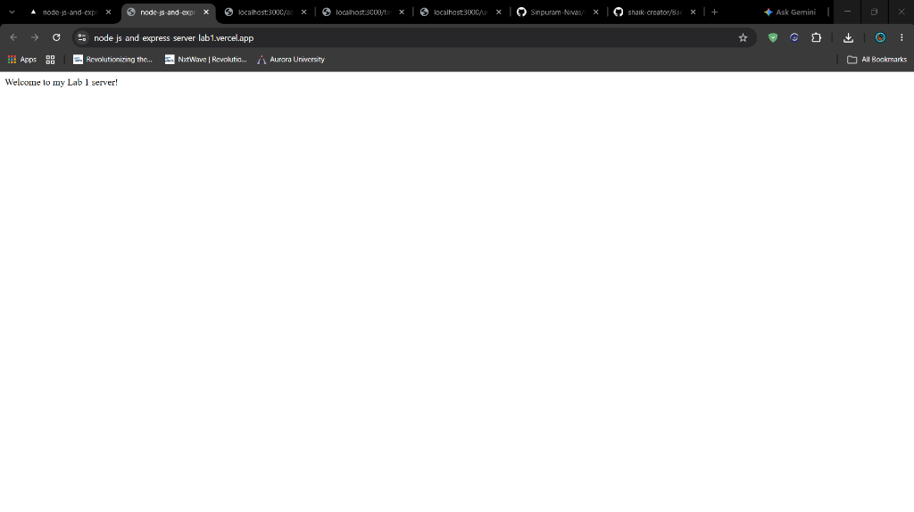
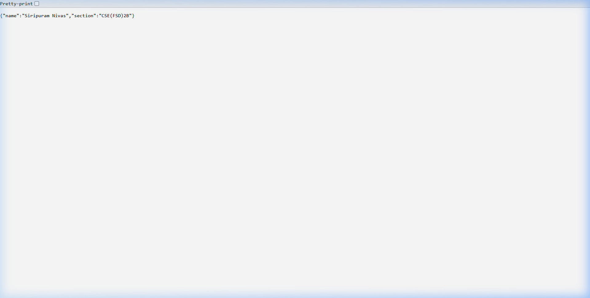
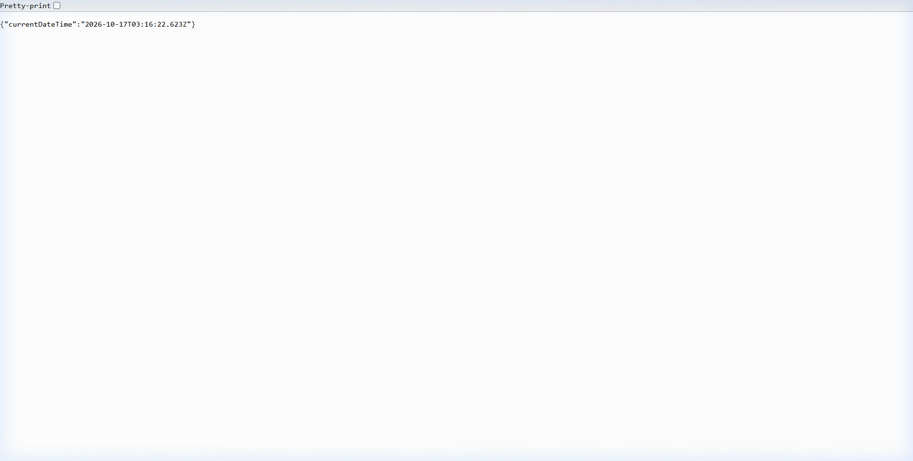

# Lab 1: Node.js and Express Server

## Student Details

| Field               | Details                                              |
| ------------------- | ---------------------------------------------------- |
| **Name**            | Siripuram Nivas                                      |
| **Registration No** | 252U1R7089                                           |
| **Section**         | CSE(FSD)2B                                           |
| **Course**          | Backend Development Fundamentals                     |
| **Lab Number**      | Lab 01                                               |
| **Live Link**       | https://node-js-and-express-server-lab1.vercel.app/  |

---

## Objective

The objective of this lab is to:

- Initialize a Node.js project using `npm init -y`
- Install and use the Express.js framework
- Create a basic HTTP server using Node.js's built-in `http` module
- Create an Express server with multiple routes
- Return correct HTTP status codes for each route
- Handle unknown routes with a 404 response
- Document the project with a README, screenshots, and proper project structure

---

## Technologies Used

- **Node.js** - JavaScript runtime environment
- **Express.js** - Minimal web framework for Node.js
- **npm** - Node Package Manager for managing dependencies

---

## Project Structure

`Node_js_and_Express_server lab1/
|-- server-http.js       # Basic HTTP server using Node.js built-in http module
|-- server.js            # Express server with all required routes
|-- package.json         # Project metadata and dependencies
|-- package-lock.json    # Exact dependency versions (auto-generated)
|-- .gitignore           # Files to exclude from Git
|-- README.md            # Project documentation (this file)
+-- screenshots/
    |-- home.png         # GET / response
    |-- about.png        # GET /about response
    |-- time.png         # GET /time response
    +-- not-found.png    # 404 unknown route response`

---

## Package.json Fields Explained

| Field          | Description                                                          |
| -------------- | -------------------------------------------------------------------- |
| `name`         | The name of the project/package (`lab-01`)                           |
| `version`      | The current version of the project (`1.0.0`)                         |
| `description`  | A short description of what the project does                         |
| `main`         | The entry point file for the project (e.g., `index.js`)              |
| `scripts`      | Shortcut commands; `start` runs `node server.js`                     |
| `keywords`     | Array of keywords for npm discovery                                  |
| `author`       | Name of the author or developer                                      |
| `license`      | The license type (ISC is a permissive open-source license)           |
| `dependencies` | Packages required to run the app in production (e.g., express)       |
| `type`         | Specifies module system; `commonjs` means require() / module.exports |

---

## Installation and Setup

### Prerequisites

- Node.js installed on your machine
- npm (comes bundled with Node.js)

### Steps to Install

1. Clone or download the project to your local machine.
2. Open a terminal in the project folder.
3. Install dependencies:

`npm install`

---

## How to Run

### Run the Basic HTTP Server

`node server-http.js`

Expected output in the terminal:
`HTTP server running at http://localhost:3000`

Open your browser and navigate to http://localhost:3000 - you should see:
`Hello`

> **Note:** Stop this server (Ctrl+C) before starting the Express server, since both use port 3000.

### Run the Express Server

`node server.js`

Expected output in the terminal:
`Express server running at http://localhost:3000`

---

## Endpoints

| Method | Endpoint  | Description                              | Expected Status |
| ------ | --------- | ---------------------------------------- | --------------- |
| GET    | /         | Returns a welcome message                | 200 OK          |
| GET    | /about    | Returns student name and section in JSON | 200 OK          |
| GET    | /time     | Returns the current date and time        | 200 OK          |
| GET    | /anything | Unknown route - example of 404           | 404 Not Found   |

> **Note:** `/anything` is just one example. Any undefined route (e.g., `/hello`, `/xyz`, `/test`) will also return a `404 Not Found` response.

### Testing the Routes

After running `node server.js`, open your browser to test:

| URL                                | Expected Response                              |
| ---------------------------------- | ---------------------------------------------- |
| http://localhost:3000/             | Welcome to my Lab 1 server!                    |
| http://localhost:3000/about        | {"name":"Your Name","section":"Your Section"}  |
| http://localhost:3000/time         | {"currentDateTime":"2026-10-17T03:15:45.116Z"} |
| http://localhost:3000/unknownroute | 404 - Page Not Found (with HTTP status 404)    |

---

## Screenshots

### GET / - Home Route (200 OK)

### GET /about - About Route (200 OK)

### GET /time - Time Route (200 OK)

### Unknown Route - 404 Not Found

---

## HTTP Status Codes

| Status Code | Name      | Meaning                                                   |
| ----------- | --------- | --------------------------------------------------------- |
| 200         | OK        | The request was successful                                |
| 404         | Not Found | The requested route/resource does not exist on the server |

---

## Viva Questions and Answers

**Q1: What is the difference between package.json and node_modules?**

`package.json` is a configuration file that lists the project's metadata and its dependencies (e.g., Express). It is small and committed to Git. `node_modules` is the folder where npm actually downloads and stores all the installed packages and their sub-packages. It can contain thousands of files and is very large, so it is never committed to Git - it is listed in `.gitignore`. Anyone who clones the project can regenerate `node_modules` by running `npm install`.

---

**Q2: What does app.listen() do?**

`app.listen(PORT, callback)` starts the Express web server and tells it to begin listening for incoming HTTP requests on the specified port number. The optional callback function runs once the server has successfully started. For example:

`js
app.listen(3000, () => {
  console.log("Express server running at http://localhost:3000");
});
`

After this line executes, the server stays running and is ready to handle requests.

---

**Q3: What do request and response represent?**

In each route handler, Express provides two objects:

- **request (req)** - Represents the incoming HTTP request from the client. It contains information such as the URL path, HTTP method, query parameters, headers, and request body.
- **response (res)** - Represents the HTTP response that the server sends back to the client. It provides methods like `response.status()`, `response.send()`, and `response.json()` to control what is returned.

---

## Problems Faced and Solutions

| Problem                                                                                                                              | Solution                                                             |
| ------------------------------------------------------------------------------------------------------------------------------------ | -------------------------------------------------------------------- |
| **Port conflict** - Running `server-http.js` and `server.js` at the same time caused an EADDRINUSE error because both use port 3000. | Stopped the first server with Ctrl+C before starting the second one. |

---

